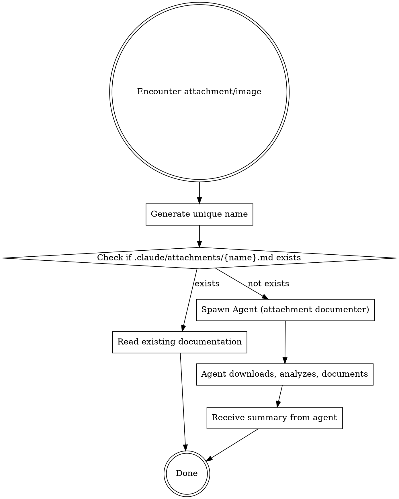

# Attachment Documenter

## Overview

When you encounter images or attachments in GitHub issues, PRs, Jira tickets, or Sentry issues, delegate to a subagent that documents them systematically. This avoids polluting your main conversation context with image analysis.

## When This Applies

This skill triggers when you:
- Fetch a GitHub issue that has images embedded or attached
- Review a GitHub PR with screenshots or design files
- Read a Jira ticket with attachments or inline images
- Investigate a Sentry issue with screenshots or visual context
- Process any external source that references visual content

## Process

**IMPORTANT**: Do NOT process attachments inline. Always spawn an Agent tool subagent.



## Naming Convention

Format: `{source}_{identifier}_{sanitized-filename}`

| Source | Format | Example |
|--------|--------|---------|
| GitHub Issue | `gh-issue_{owner}-{repo}-{number}_{filename}` | `gh-issue_acme-app-123_screenshot.png` |
| GitHub PR | `gh-pr_{owner}-{repo}-{number}_{filename}` | `gh-pr_acme-app-456_design-mockup.png` |
| Jira | `jira_{ticket-id}_{filename}` | `jira_PROJ-789_error-screenshot.png` |
| Sentry | `sentry_{issue-id}_{filename}` | `sentry_12345_crash-screenshot.png` |

**Filename sanitization:**
- Replace spaces with hyphens
- Remove special characters except hyphens and dots
- Lowercase everything
- Truncate to 50 chars if longer (preserve extension)

## Directory Structure

All attachments and their documentation are stored together in the project's `.claude/attachments/` directory:

```
{project}/
└── .claude/
    └── attachments/
        ├── gh-issue_acme-app-123_screenshot.png      # actual image
        ├── gh-issue_acme-app-123_screenshot.md       # documentation
        ├── gh-pr_acme-app-456_design-mockup.png
        ├── gh-pr_acme-app-456_design-mockup.md
        ├── jira_PROJ-789_error-screenshot.jpg
        ├── jira_PROJ-789_error-screenshot.md
        ├── sentry_12345_crash-screenshot.png
        └── sentry_12345_crash-screenshot.md
```

This keeps attachments persistent across sessions and colocated with their documentation.

## Documentation File Format

Each `.md` file in `.claude/attachments/` should contain:

```markdown
# {Original Filename}

## Source
- **Type**: GitHub Issue / GitHub PR / Jira Ticket
- **Reference**: {URL or identifier}
- **Original URL**: {direct URL to attachment}
- **Downloaded**: {timestamp}

## Task Context
{Ticket title and what the task requires - passed by caller}

## Visual Description
{What is visible in the image:
- UI elements shown
- Text content visible
- Error messages
- Layout/design elements
- Any notable details}

## Task Relevance
{How this image relates to the task - which components/areas are shown,
what specifically needs to change based on the task requirements,
any actionable details like visible text labels or component names that help locate code}
```

## Implementation Steps

### 1. Check for existing documentation FIRST

```bash
mkdir -p .claude/attachments

ls .claude/attachments/{generated-name}.md 2>/dev/null
```

If the `.md` file exists, just read it and use the cached documentation. **Do NOT spawn an agent.**

### 2. Spawn Agent for NEW attachments only

If documentation doesn't exist, use the Agent tool with these parameters:

```
Agent tool parameters:
- description: "Document {source} attachment"
- subagent_type: "attachment-documenter"
- prompt: (see template below)
```

**Prompt template for the agent:**

```
Document the following attachment for caching:

Source: {GitHub Issue / GitHub PR / Jira Ticket / Sentry Issue}
Reference: {URL or identifier}
Attachment URL: {direct URL to the image/file}
Generated name: {generated-name}
Task context: {Ticket title + 1-2 sentence description of what the task requires}

Instructions:
1. Create directory if needed: mkdir -p .claude/attachments
2. Download the attachment: curl -L -o ".claude/attachments/{generated-name}.png" "{attachment-url}"
3. Read and analyze the downloaded image using the Read tool
4. Create documentation file at .claude/attachments/{generated-name}.md with full documentation
5. Return a 2-3 sentence summary
```

### 3. Use the agent's summary

The agent will return a brief summary. Use this in your main conversation instead of the full image analysis.

## Example Workflow

**Input:** Processing GitHub issue `https://github.com/acme/app/issues/123` which contains an image `error-screenshot.png` showing a login error.

**Generated name:** `gh-issue_acme-app-123_error-screenshot`

**Step 1 - Check cache:** `ls .claude/attachments/gh-issue_acme-app-123_error-screenshot.md`

**If exists:** Read the .md file and use its content. Done.

**If not exists - Step 2 - Spawn agent:**

```
Agent tool call:
- description: "Document gh-issue attachment"
- subagent_type: "attachment-documenter"
- prompt: |
    Document the following attachment for caching:

    Source: GitHub Issue
    Reference: https://github.com/acme/app/issues/123
    Attachment URL: https://user-images.githubusercontent.com/xxx/error-screenshot.png
    Generated name: gh-issue_acme-app-123_error-screenshot
    Task context: "Fix login error after session timeout" - Users see an error when attempting to log in after their session expires. Need to handle expired session tokens gracefully.

    Instructions:
    1. mkdir -p .claude/attachments
    2. curl -L -o ".claude/attachments/gh-issue_acme-app-123_error-screenshot.png" "https://user-images.githubusercontent.com/xxx/error-screenshot.png"
    3. Read and analyze the image
    4. Create .claude/attachments/gh-issue_acme-app-123_error-screenshot.md with full documentation
    5. Return a 2-3 sentence summary
```

**Step 3 - Use summary:** Agent returns something like:
> "Screenshot shows a login form with a red error banner displaying 'Session expired. Please log in again.' The email field is pre-filled but password is empty. Confirms the session timeout UX issue."

Use this summary in your main conversation. The full details are cached in the .md file for future sessions.

## Common Mistakes

| Mistake | Fix |
|---------|-----|
| Analyzing images inline | ALWAYS spawn an Agent tool subagent -- never analyze in main context |
| Spawning agent for cached attachment | Check if .md file exists FIRST, only spawn if missing |
| Re-downloading same image | Always check `.claude/attachments/` first |
| Inconsistent naming | Follow exact naming convention above |
| Missing context | Include ticket/issue context in agent prompt |

## When NOT to Apply

- Attachments in messages within the current conversation (not persistent)
- Generic documentation images that aren't specific to an issue
- Code files or text attachments (these don't need visual documentation)

## Why This Approach

**Context isolation**: Image analysis can consume significant context. By delegating to a haiku agent:
- Your main conversation stays focused on the task
- You only receive a brief summary (2-3 sentences)
- Full analysis is cached in .md files for future sessions
- Haiku is faster and cheaper for visual analysis tasks
