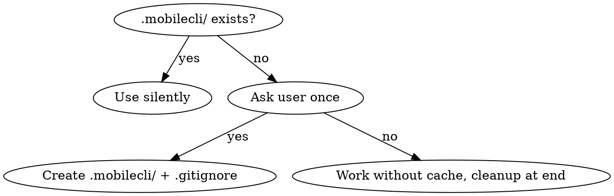

# Mobile App Automation with mobilecli

## Overview

mobilecli is a CLI for controlling iOS and Android devices (real + simulators/emulators). The core principle: **use `dump ui` cached to files + jq queries for element finding**. Screenshots are a last resort.

**Performance rule**: Cache UI dumps to `.mobilecli/cache/` files. Query with jq one-liners. Never spawn agents for simple element finding or verification -- use bash scripts instead. Only use subagents for initial deeplink research and batched multi-step test flows (5+ sequential tests).

## Quick Start

```bash
mobilecli devices
mobilecli dump ui --device <id> > .mobilecli/cache/screen.json
jq -r '.data.elements[] | select(.label // .text // "" | test("Submit"; "i")) | "\(.rect.x + .rect.width/2 | floor),\(.rect.y + .rect.height/2 | floor)"' .mobilecli/cache/screen.json | head -1
mobilecli io tap --device <id> 305,434
mobilecli url --device <id> myapp://article/123
mobilecli io text --device <id> "search query"
```

## Pre-flight Check (MANDATORY before automating)

Before running any test flow, verify the app is launchable using the `launch_app` helper (polls `apps foreground` until the app appears, no fixed sleep):

```bash
source "${CLAUDE_SKILL_DIR}/test-helpers.sh"
launch_app
```

**If app crashes on launch:** Don't try to build it yourself. Tell the user the app isn't running and ask them to build/install it. Once they confirm it's running, continue.

## Device Selection

When `mobilecli devices` returns multiple devices, **ask the user which one to use**.

**Tradeoffs:**
- **Simulator/emulator:** No signing config needed, faster to reset, but may not match real device behavior
- **Real Android device:** Zero signing setup, true device behavior, best for quick testing
- **Real iOS device:** Requires Apple Developer team + provisioning, but most accurate iOS testing

When in doubt, ask the user which device they prefer.

## Commands

### Device Management

```bash
mobilecli devices
mobilecli devices --include-offline --platform ios --type simulator
mobilecli device boot --device <id>
mobilecli device shutdown --device <id>
mobilecli device reboot --device <id>
mobilecli device info --device <id>
mobilecli device orientation get --device <id>
mobilecli device orientation set --device <id> landscape
```

**Booting simulators:** `device boot` starts the simulator runtime but does NOT open the Simulator.app window. On macOS, also run `open -a Simulator` to show the window. Wait a few seconds after boot before launching apps.

### UI Tree (Primary Navigation Method)

```bash
mobilecli dump ui --device <id>
mobilecli dump ui --device <id> --format raw
```

Output includes per element: `type`, `label`, `name`, `identifier`, `text`, `value`, `rect {x, y, width, height}`.

**Tap target calculation**: `center_x = x + width/2`, `center_y = y + height/2`

### Input/Interaction

**Android React Native TextInput note:** `mobilecli io text` and `adb shell input text` may not work with React Native Fabric TextInputs because UIAutomator runs outside the app process. The `fill_input` and `fill_by_label` helpers handle this automatically by enabling `show_ime_with_hard_keyboard` on Android, which forces the soft keyboard to appear when ADB taps focus an input.

```bash
mobilecli io tap --device <id> 100,200
mobilecli io longpress --device <id> 100,200
mobilecli io longpress --device <id> 100,200 --duration 2000
mobilecli io swipe --device <id> 100,600,100,200        # swipe up
mobilecli io swipe --device <id> 100,200,100,600        # swipe down
mobilecli io swipe --device <id> 300,400,50,400         # swipe left
mobilecli io button --device <id> HOME
mobilecli io button --device <id> BACK
mobilecli io button --device <id> VOLUME_UP
mobilecli io text --device <id> "hello world"
```

### URL / Deeplinks

```bash
mobilecli url --device <id> https://example.com
mobilecli url --device <id> myapp://article/123
```

### App Management

```bash
mobilecli apps list --device <id>
mobilecli apps foreground --device <id>
mobilecli apps launch --device <id> com.example.app
mobilecli apps terminate --device <id> com.example.app
mobilecli apps install --device <id> /path/to/app.apk
mobilecli apps uninstall --device <id> com.example.app
```

**Response formats:**
- `apps list` returns `{"status":"ok","data":[{"packageName":"...","appName":"...","version":"..."},...]}`
  - `data` is a **flat array** (not `{apps:[...]}`). Keys: `packageName`, `appName`, `version`.
- `apps foreground` returns `{"status":"ok","data":{"packageName":"...","appName":"...","version":"..."}}`
- `apps launch` returns `{"status":"ok","data":{"message":"Launched app..."}}`

### Screenshots (Last Resort)

```bash
mobilecli screenshot --device <id>
mobilecli screenshot --device <id> -o screen.png
mobilecli screenshot --device <id> -f jpeg -q 85 -o screen.jpg
mobilecli screenshot --device <id> -o -    # stdout
```

### Screen Streaming

```bash
mobilecli screencapture --device <id> -f mjpeg
mobilecli screencapture --device <id> -f mjpeg --fps 15 --scale 0.5
```

### Server (HTTP/WebSocket API)

```bash
mobilecli server start --listen localhost:12000 --cors
mobilecli server start --daemon
mobilecli server kill
```

## Navigation Strategy (Priority Order)

1. **Deeplinks** -- `mobilecli url` for instant navigation when you don't need to test the navigation path itself.
2. **Cached dump + tap** -- Dump UI to file, find element with jq, tap coordinates. Use when testing actual navigation flows.
3. **Hardware buttons** -- `io button BACK` / `HOME` for common navigation. **Warning:** On Android, BACK at the navigation root exits the app entirely. Prefer deeplinks to navigate away.
4. **Swipe + re-dump** -- For off-screen elements, swipe then dump again.
5. **Screenshot** -- Only when UI tree lacks useful labels/identifiers.

**When to use deeplinks vs taps:**
- Deeplink: Setup/reset, navigating to a starting point, when the navigation itself isn't being tested
- Tap: When testing that a button/link actually works, verifying navigation flows

## Deeplink Pitfalls

### Same-screen deeplink won't refresh

Opening a deeplink to the screen you're already on does NOT remount the screen. Navigate to a different screen first:

```bash
navigate "other-screen" "Other Landmark"
navigate "screen/123" "Screen Title"
```

### Cold start timing

After `apps launch`, the app may not be ready for deeplinks immediately. Don't blindly `sleep` -- either:
- Poll `apps foreground` until the app's package name appears
- Or ask the user to confirm the app is loaded before sending deeplinks

## Scripted Interaction (Primary Approach)

**Use bash + jq for all element finding and verification.** This is orders of magnitude faster than spawning subagents.

## Test Helpers

Centralized helper functions live in [test-helpers.sh](test-helpers.sh) (alongside this SKILL.md). Source it in every test script by resolving its absolute path from this skill's directory. It requires these env vars:

```bash
# Required env vars (set before sourcing):
#   DEVICE          - mobilecli device ID
#   APP_BUNDLE      - app bundle/package ID (e.g. com.example.app)
#   DEEPLINK_SCHEME - deeplink scheme (e.g. myapp)
#   CACHE_DIR       - directory to cache UI dumps (default: .mobilecli/cache)
```

**Available functions** (see test-helpers.sh for implementation):

**Prefer one-liners** -- these do a fresh dump + action in a single call. Use the low-level helpers only when you need fine-grained control or are reusing a cached dump.

### One-liners (auto-dump, use these first)

| Function | Purpose |
|----------|---------|
| `screen_text [name]` | Fresh dump + all visible text. Replaces `dump_ui` + `all_text` |
| `tap_text <regex> [verify_regex] [name]` | Fresh dump + find + tap + optional verify (6s). Replaces `dump_ui` + `find_el` + `tap` + `wait_for` |
| `assert_screen <landmark> [msg]` | Fresh dump + assert text present. Prints actual screen text on failure |
| `el_info <regex>` | Fresh dump + element details (type, bounds, center, text) |
| `clickable_els` | Fresh dump + list all interactive elements with coords |
| `els_at <x> <y>` | Fresh dump + find all elements containing a point |
| `els_in_region <x1> <y1> <x2> <y2>` | Fresh dump + find all elements whose center falls within a rectangular region |
| `fill_by_label <regex> <text>` | Fresh dump + find input by regex + tap + type text (platform-aware) |

### Cached element helpers (use existing dump file)

| Function | Purpose |
|----------|---------|
| `tap_el <file> <regex>` | Find + tap from cached dump (returns 1 if not found) |
| `el_props <file> <regex>` | Element properties from cached dump (type, bounds, center, text) |
| `els_at_point <file> <x> <y>` | Elements at point from cached dump |
| `els_in_region_cached <file> <x1> <y1> <x2> <y2>` | Elements whose center falls within region from cached dump |

### Low-level helpers

| Function | Purpose |
|----------|---------|
| `dump_ui <name>` | Dump UI tree, cache to `$CACHE_DIR/<name>.json`, return path |
| `cached <name>` | Get path to cached dump |
| `dump_if_stale <name> [max_age]` | Re-dump only if cache older than N seconds (default 10) |
| `find_el <file> <regex>` | Find element center coords by regex on label/text/name/identifier |
| `find_exact <file> <text>` | Find element by exact text match |
| `has_text <file> <regex>` | Check if text exists on screen (returns 0/1) |
| `el_y <file> <regex>` | Get element's Y coordinate |
| `all_text <file>` | Get all visible text in DOM order, deduped |
| `tap <x,y>` | Tap coordinates |
| `tap_and_verify <x,y> <expected> [name]` | Tap then poll until expected text appears (6s timeout) |
| `longpress <x,y> [duration_ms]` | Long press |
| `type_text <text>` | Type into focused field |
| `fill_input <x,y> <text> [--no-dismiss]` | Tap input + type text + auto-dismiss focus (platform-aware). Pass `--no-dismiss` to keep focus |
| `dismiss_focus` | Dismiss keyboard and unfocus active TextInput (BACK + tap neutral area) |
| `swipe <x1,y1,x2,y2>` | Swipe gesture |
| `swipe_up` / `swipe_down` | Vertical swipe shortcuts |
| `wait_for <regex> [timeout] [name]` | Poll `dump ui` until text appears. Returns dump path |
| `wait_until_gone <regex> [timeout] [name]` | Poll until text disappears. Returns dump path |
| `on_screen <landmark>` | Quick check: is landmark text on current screen? (returns 0/1) |
| `navigate <path> [landmark] [timeout]` | Deeplink navigate. If landmark given, polls for it; otherwise 0.5s fallback |
| `go_back [landmark]` | BACK button. If landmark given, polls for it. **WARNING: exits app at nav root on Android** |
| `go_home` | HOME button |
| `launch_app [timeout]` | Launch app, poll `apps foreground` until confirmed (default 10s) |
| `check_foreground` | Verify app is in foreground (returns 0/1) |
| `pass <n> <msg>` / `issue <n> <msg>` / `skip <n> <msg>` | Test result reporting |

### Usage Pattern

The main agent uses these helpers directly in Bash tool calls. Write env vars to `.mobilecli/env.sh` once during setup, then each Bash call is just 2 lines of boilerplate:

```bash
source .mobilecli/env.sh
source "${CLAUDE_SKILL_DIR}/test-helpers.sh"
```

**Prefer one-liners** for most operations:

```bash
source .mobilecli/env.sh && source "${CLAUDE_SKILL_DIR}/test-helpers.sh"

screen_text                           # see what's on screen
tap_text "Settings" "Theme"           # tap Settings, verify Theme appears
assert_screen "Theme"                 # assert we're on the right screen
el_info "Dark"                        # inspect element details
clickable_els                         # list tappable elements
```

**Use low-level helpers** only when you need to reuse a cached dump across multiple operations:

```bash
source .mobilecli/env.sh && source "${CLAUDE_SKILL_DIR}/test-helpers.sh"

navigate "settings" "Theme" 5
F=$(cached "nav-settings")
tap_el "$F" "Notifications"
el_props "$F" "Dark mode"
```

### Multi-step Interaction Pattern

Chain one-liners for complex flows -- batch multiple steps into a single Bash call:

```bash
source .mobilecli/env.sh && source "${CLAUDE_SKILL_DIR}/test-helpers.sh"

navigate "products" "Running Shoes" 5
tap_text "Running Shoes" "Add to cart" && pass 1 "Product detail loaded" || issue 1 "Navigation failed"
tap_text "Add to cart" "Cart" && pass 2 "Added to cart" || issue 2 "Add to cart failed"
```

### Screen Identity

Use `assert_screen` for screen checks with diagnostics on failure, or `on_screen` for quick boolean checks:

```bash
assert_screen "Settings"
on_screen "Settings" && echo "on settings" || echo "not on settings"
```

## When to Use Subagents

Only use subagents for:

### 1. Deeplink Researcher (first-time per project)

Dispatch once to discover the app's deeplink schema. Results cached to `.mobilecli/deeplinks.md`.

```
Research deeplink configuration for the app in this codebase.
Search for: scheme field, route definitions, linking configuration.
Write results to .mobilecli/deeplinks.md.
```

### 2. Batched Multi-Test Flows (5+ sequential tests)

When running a full UAT suite, a single subagent can execute many tests sequentially faster than the main agent making individual Bash calls (fewer round-trips). The subagent should use the same test-helpers.sh approach internally.

**Single device = sequential only.** Never run parallel subagents on the same device.

## Cache Strategy (.mobilecli/)

### Permission Logic



### File Structure

```
.mobilecli/
  env.sh                # Env vars (DEVICE, APP_BUNDLE, etc.) -- source to reduce boilerplate
  deeplinks.md          # App deeplink schema (rarely changes)
  device-context.md     # Cached device info (id, platform, screen size)
  cache/
    programs-tab.json   # Cached dump ui output per screen
    browse-screen.json
    settings.json
```

### Cache Lifecycle

- **UI dumps** (`cache/*.json`): Valid for ~10 seconds by default. Use `dump_if_stale` to reuse. Always re-dump after navigation or interaction that changes the screen.
- **deeplinks.md**: Valid until route files change. Quick grep to validate.

### .gitignore

On first `.mobilecli/` creation, add to `.gitignore` if not already present:
```
# mobilecli automation cache
.mobilecli/
```

## Workflow Examples

### Navigate to a specific screen

```bash
source "${CLAUDE_SKILL_DIR}/test-helpers.sh"
navigate "article/456" "Article Title" 5
on_screen "Article Title" && echo "Loaded" || echo "Failed"
```

### Tap through UI

```bash
source "${CLAUDE_SKILL_DIR}/test-helpers.sh"
tap_text "Settings" "Notifications"
tap_text "Notifications"
```

### Fill a form

```bash
source "${CLAUDE_SKILL_DIR}/test-helpers.sh"
navigate "signup" "email" 5
fill_by_label "email" "user@example.com"
fill_by_label "password" "secret123"
tap_text "Submit" "Welcome"
```

For fine-grained control with cached dumps:

```bash
source "${CLAUDE_SKILL_DIR}/test-helpers.sh"
navigate "signup" "email" 5
F=$(cached "nav-signup")
EMAIL_XY=$(find_el "$F" "email")
fill_input "$EMAIL_XY" "user@example.com"
```

### Scroll to find element

```bash
source "${CLAUDE_SKILL_DIR}/test-helpers.sh"
F=$(dump_ui "long-page")
TARGET=$(find_el "$F" "Privacy Policy")
if [ -z "$TARGET" ]; then
  swipe_up
  F=$(wait_for "Privacy Policy" 3 "long-page-scrolled")
  TARGET=$(find_el "$F" "Privacy Policy")
fi
[ -n "$TARGET" ] && tap "$TARGET"
```

### UAT Flow (Bash tool calls)

Each Bash tool call sources helpers then runs one or more test steps:

```bash
source .mobilecli/env.sh && source "${CLAUDE_SKILL_DIR}/test-helpers.sh"
launch_app
navigate "" "Welcome" 5
assert_screen "Welcome" && pass 1 "Home loaded" || issue 1 "Welcome text missing"
```

```bash
source .mobilecli/env.sh && source "${CLAUDE_SKILL_DIR}/test-helpers.sh"
tap_text "Settings" "Account" && pass 2 "Settings loaded" || issue 2 "Settings navigation failed"
tap_text "Notifications" "Enabled" && pass 3 "Toggle worked" || issue 3 "Toggle failed"
```

## Known Limitations

### UIAutomator fails on timer/animation screens (Android)

Screens with constantly updating timers or animations prevent UIAutomator from reaching "idle" state. Both `mobilecli dump ui` and raw `adb shell uiautomator dump` return 0 elements. `dump_ui` retries 3 times but won't help if the timer never stops.

**Workaround**: Use `mobilecli screenshot` for visual verification + coordinate-based tapping. Navigate away from the timer screen to do UI dumps, then navigate back.

### Empty TextInputs invisible in UI dump

React Native TextInputs with no value don't always appear as `EditText` in UIAutomator dumps. Only filled fields are reliably visible.

**Workaround**: Calculate empty field coordinates relative to visible elements (e.g., same X as a filled weight field, Y offset per row).

### Recommended global permissions

Add to your Claude settings.json so helper scripts don't trigger permission prompts:

```json
{
  "permissions": {
    "allow": [
      "Bash(source:*)",
      "Bash(mobilecli:*)",
      "Bash(adb:*)",
      "Bash(cat:*)",
      "Bash(jq:*)"
    ]
  }
}
```

## Common Mistakes

| Mistake | Fix |
|---------|-----|
| Writing `dump_ui` + `find_el` + `tap` as 3 steps | Use `tap_text "regex" "verify"` -- one call does all three |
| Writing `dump_ui` + `all_text` to read screen | Use `screen_text` -- one call |
| Writing `dump_ui` + `has_text` to check screen | Use `assert_screen "landmark"` -- one call with diagnostics |
| Writing manual jq to inspect element properties | Use `el_info "regex"` or `el_props <file> "regex"` |
| Spawning agent to find a single element | Use `find_el` jq helper instead |
| Using `sleep` after tap/navigate | Use `tap_text` with verify, `wait_for`, or `navigate` with landmark |
| Taking screenshots to check screen state | Use `assert_screen`/`on_screen` -- faster, no visual processing needed |
| Full `screen_text` dump to check "what screen?" | Use `assert_screen "landmark"` or `on_screen` with one key element |
| One operation per Bash tool call | Batch 3-5 steps into single calls to reduce context overhead |
| Dumping UI without caching to file | Always dump to `$CACHE_DIR/name.json` or use auto-dump helpers |
| Re-dumping when screen hasn't changed | Use `dump_if_stale` or cached helpers (`tap_el`, `el_props`, `els_at_point`) |
| Using screenshots to find elements | Use dump ui + jq first, screenshot only as last resort |
| Guessing coordinates without dump ui | Always get coords from cached dump via jq |
| Re-researching deeplinks every time | Check .mobilecli/deeplinks.md cache first |
| Using `xcrun simctl` instead of mobilecli | mobilecli works cross-platform (iOS + Android) |
| Inventing mobilecli commands | Only use commands listed in this skill |
| Forgetting `--device` flag | Required on nearly every command |
| Using BACK to navigate away on Android | BACK at nav root kills the app -- use deeplinks instead |
| Re-opening same deeplink to refresh | Same-screen deeplink won't remount -- navigate away first |
| Sending deeplink right after app launch | App may not be ready -- use `launch_app` which polls |
| Assuming which device to use | Ask user when multiple devices are connected |
| Running parallel subagents on same device | One device = sequential only. Parallel requires multiple devices |
| Skipping pre-flight check | Always verify app launches before starting test flow |
| Trying to build/install app yourself | Ask user to build. Don't run build commands for them |
| Using `type_text` to fill RN TextInputs on Android | Use `fill_input` or `fill_by_label` -- they handle Android keyboard quirks |
| Using `dump_ui` on a screen with running timer/animation | UIAutomator can't reach idle state -- use `mobilecli screenshot` instead |
| Chaining `fill_input` then `dump_ui` without dismissing focus | `fill_input` auto-dismisses now; if using `--no-dismiss`, call `dismiss_focus` before dump |
| Passing text with spaces to `fill_input` on Android | Spaces are auto-encoded as `%s` for ADB; verify complex strings work |

## Debug Mode (`--debug`)

**Skip this section unless `--debug` was passed.** When active, read and follow [DEBUG-MODE.md](DEBUG-MODE.md) -- it monitors your execution for deviation signals (using screenshots instead of helpers, writing manual jq, repeated sequences) and logs fix-ready entries to GAPS.md.

## Red Flags - STOP

- About to write `dump_ui` + `find_el` + `tap` -> use `tap_text "regex" "verify"` instead
- About to write `dump_ui` + `all_text` -> use `screen_text` instead
- About to write `dump_ui` + `has_text` to assert -> use `assert_screen "landmark"` instead
- About to write manual jq to get element info -> use `el_info "regex"` instead
- About to write `sleep` after a tap or navigate -> use `tap_text` with verify, `wait_for`, or `navigate` with landmark
- About to take a screenshot to check screen state -> use `assert_screen` or `on_screen` instead
- About to make a single-operation Bash call -> batch with adjacent operations
- About to spawn an agent just to find one element -> use `find_el` jq helper
- Guessing a mobilecli command not listed here -> check this reference
- Using xcrun simctl for something mobilecli can do -> use mobilecli
- About to research deeplinks again -> check .mobilecli/deeplinks.md
- About to use BACK to leave a screen on Android -> use deeplink to a different screen instead
- Re-opening same deeplink expecting a refresh -> navigate away first, then back
- About to launch parallel subagents on same device -> sequential only, one device = one subagent at a time
- App crashed on launch -> don't try to build it, ask user to fix and confirm
- Cache dump is older than 10s and you're looking for elements -> re-dump first
- dump_ui returning 0 elements on a screen with a running timer -> UIAutomator can't get idle state, use screenshot instead
- About to dump UI right after fill_input with `--no-dismiss` -> call `dismiss_focus` first
